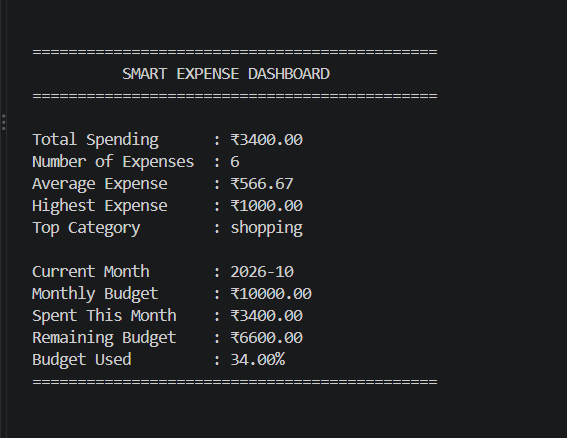
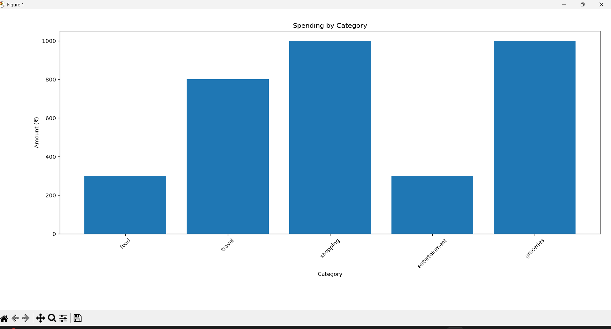
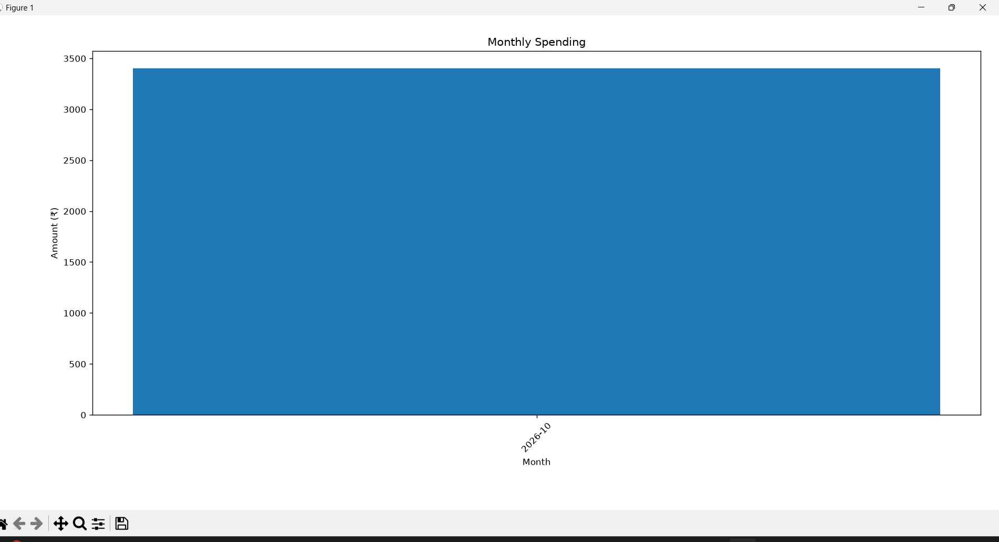
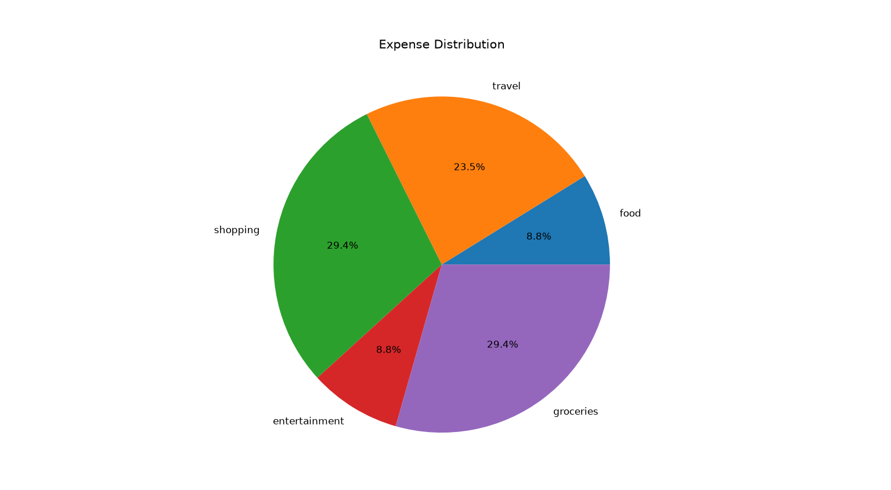

# Smart Expense Tracker

A beginner-friendly Python expense management application that helps users record, manage, analyze, and visualize their daily expenses.

## Features

- Add expenses with automatic date tracking
- View all expenses
- Edit existing expenses
- Delete expenses
- Search expenses by category or description
- Calculate total spending
- View category-wise spending
- Find the highest expense
- Set a monthly budget
- Check current budget status
- View monthly spending summary
- Filter expenses by month
- Generate category spending charts
- Generate monthly spending charts
- Generate expense distribution pie charts
- View an expense dashboard
- Store expense data using CSV files

## Technologies Used

- Python
- CSV
- Matplotlib
- File Handling
- Date and Time
- Python Modules

## Project Structure

```text
Smart-Expense-Tracker/
│
├── expense_tracker.py
├── reports.py
├── charts.py
├── expenses.csv
├── budget.txt
├── requirements.txt
├── README.md
└── .gitignore


## Screenshots

### Dashboard
The dashboard provides an overview of total spending, average expense, highest expense, top spending category, and monthly budget status.



### Category Spending Chart
Visualizes total spending across different expense categories.



### Monthly Spending Chart
Shows spending trends across different months.



### Expense Distribution
Displays the percentage distribution of expenses by category.

